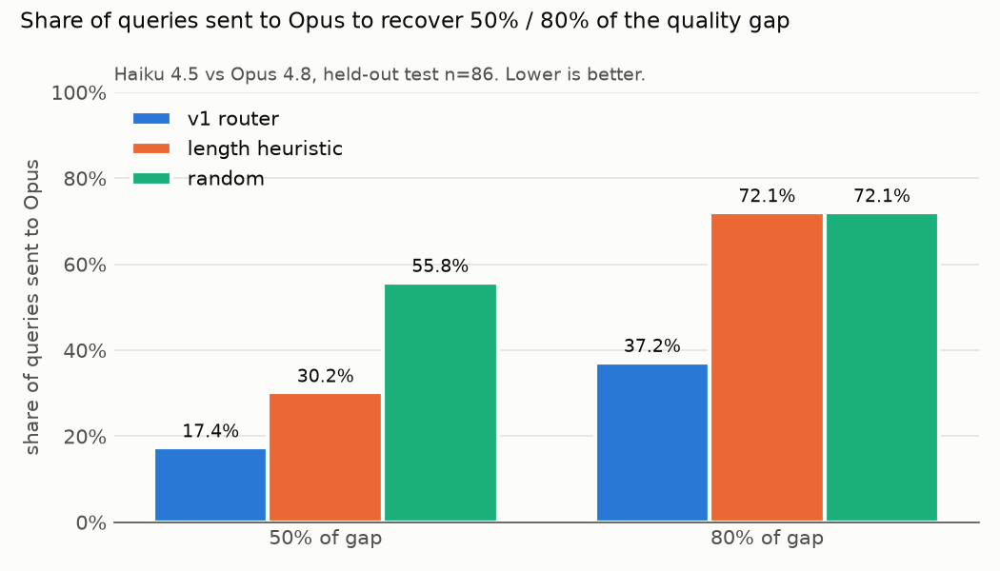
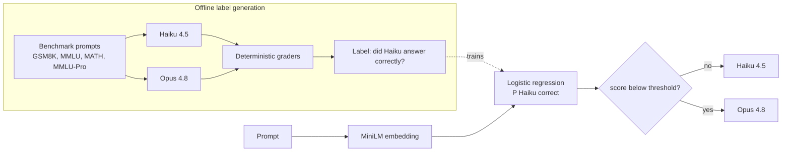

# tiered-model-router

[](https://github.com/PeterP22/tiered-model-router/actions/workflows/ci.yml) [](LICENSE)

A small learned router that sends each prompt to Claude Haiku 4.5 or Claude Opus 4.8.

**Recovers 80% of the Opus-over-Haiku quality gap while sending 37.2% of queries to Opus (random routing: 72.1%); APGR 0.7374 vs 0.5543 for random.** (`artifacts/v1/eval.json`)



Full cost/quality curves: [artifacts/v1/curves.png](artifacts/v1/curves.png).

## How it works



The threshold is a cost dial: sweeping it traces the whole cost/quality curve from one trained model.

## Key decisions

- **Correctness labels, not preferences:** answers are graded deterministically, so the label is "Haiku was right", not one noisy human vote.
- **Same tiny model for v0 and v1:** frozen `all-MiniLM-L6-v2` embeddings + class-weighted logistic regression, so any gain is attributable to the labels.
- **Label where the gap is:** a stratified probe located the difficulty band where Haiku and Opus disagree, and the main labeling run was weighted toward it while keeping easy anchors.
- **What didn't work:** v0 trained on Arena human-preference labels reached val AUC 0.506 (chance). Swapping in correctness labels, with the model unchanged, gave val AUC 0.710 (both from the training runs reported in commit `b07102a`).

## Results

Held-out test split, `artifacts/v1/eval.json`. APGR = area under the curve of quality-gap-recovered vs share sent to Opus (higher is better). cpt_50 / cpt_80 = smallest share of queries sent to Opus that recovers 50% / 80% of the Haiku-to-Opus quality gap (lower is better). Quality = fraction of prompts answered correctly by the routed model.

| policy | share to Opus | APGR | cpt_50 | cpt_80 | quality | $/prompt |
|---|---|---|---|---|---|---|
| v1 router | swept | 0.7374 | 0.174 | 0.372 | - | - |
| length heuristic | swept | 0.5688 | 0.302 | 0.721 | - | - |
| random | swept | 0.5543 | 0.558 | 0.721 | - | - |
| always-Haiku | 0.0 | - | - | - | 0.7442 | $0.002564 |
| always-Opus | 1.0 | - | - | - | 0.8837 | $0.006058 |
| tier-rule baseline* | 0.6279 | - | - | - | 0.8721 | $0.0053 |

\*Routes MATH L4/L5 and MMLU-Pro to Opus using dataset metadata a deployed router would not see; it recovers 0.9167 of the gap.

The test set is n_test=86 held-out prompts (of 570 labeled, split 399/85/86), so these numbers carry wide confidence intervals; benchmark prompts are also not production traffic. Reproducing `eval.json` needs an `ANTHROPIC_API_KEY` to regenerate labels (`scripts/prepare_probe_prompts.py`, `scripts/prepare_main_prompts.py`, `scripts/generate_labels.py`), then `scripts/train_v1.py` and `scripts/eval_v1.py`. Total API spend for the measured run was $5.32 (README at commit `b07102a`).

## Quickstart

```bash
git clone https://github.com/PeterP22/tiered-model-router && cd tiered-model-router
uv sync
uv run python scripts/plot_summary.py  # rebuilds docs/routing_summary.png from artifacts/v1/eval.json, no API key
```

MIT · built by Peter Preketes
